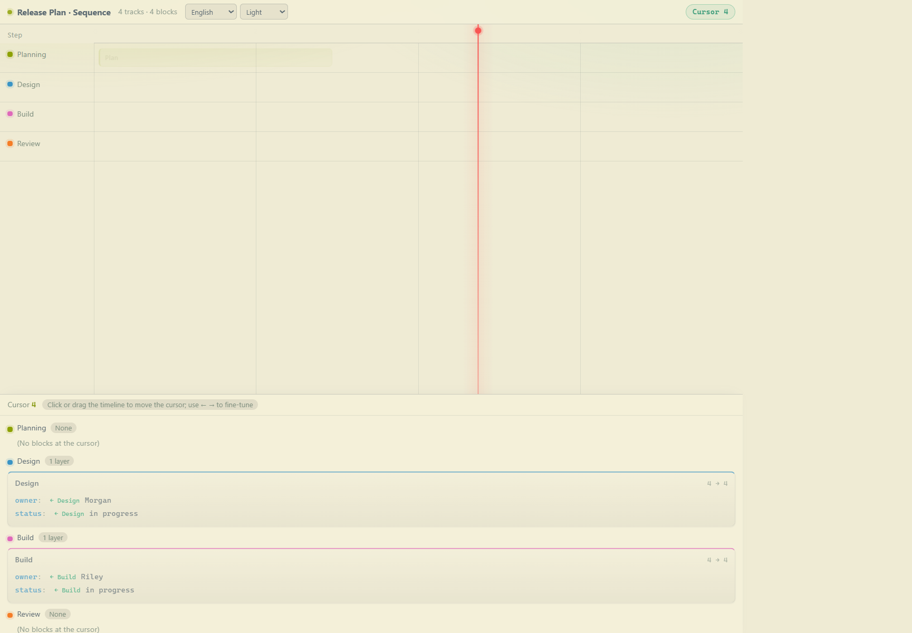
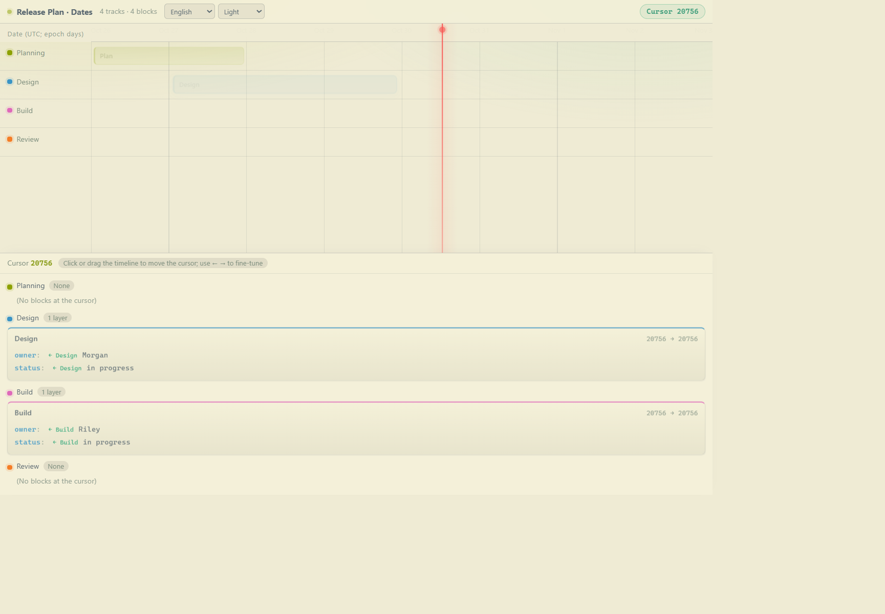
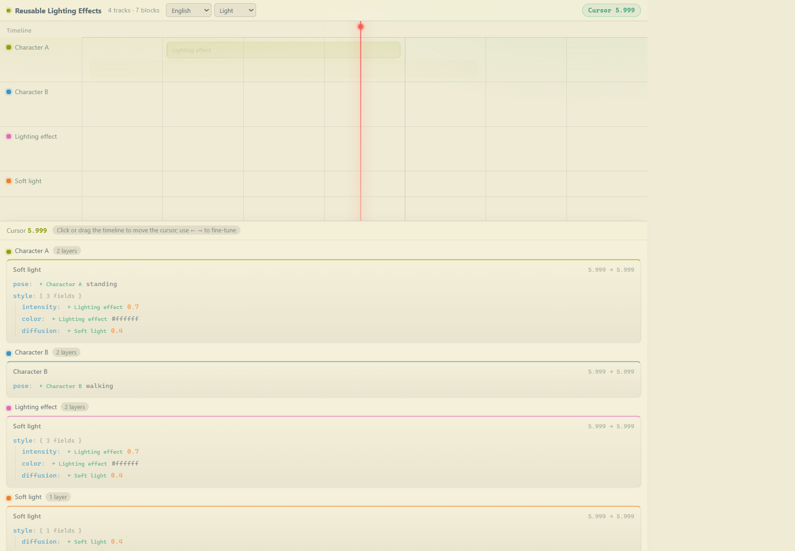

# Time Ledger MCP

[English](./README.md) | [简体中文](./README.zh-CN.md)

Time Ledger MCP turns structured ledgers into interactive timelines. Load a ledger with `show`, then move the cursor to inspect the details active at each point.

The server keeps only the most recently loaded ledger in memory. It does not write ledger data to disk, and the cache is cleared when the server exits.

## Screenshots

**Sequence-number axis**



**Date-labeled numeric axis**



**Nested ID composition**



[Read this guide in Chinese](./README.zh-CN.md).

## Requirements

- Node.js 18 or newer
- An MCP-compatible client

## Install

Install the dependencies from the repository directory:

```powershell
npm install
```

To use the server globally in VS Code, add it to the user-level `mcp.json`. Replace the example path with the absolute path to this repository:

```json
{
  "servers": {
    "time-ledger": {
      "type": "stdio",
      "command": "node",
      "args": ["C:/path/to/time-ledger-mcp/src/server.js"]
    }
  }
}
```

VS Code starts the stdio server when needed and manages its lifetime with the client.

## Tools

| Tool | What it does |
| --- | --- |
| `show` | Loads a ledger, replaces the in-memory cache, and returns the local page URL. The input can be a ledger object, a JSON file path, or JSON text. |
| `open` | Opens the local page in the system browser. |
| `help` | Explains the ledger format and display behavior. English is the default; pass `{"language":"zh"}` to read it in Chinese. |

## First use

1. Call `help` (or `help` with `{"language":"zh"}`) before creating or changing ledger JSON. It is the authoritative format reference.
2. Choose a sample such as `examples/sequence-ledger.json`, `examples/date-ledger.json`, or `examples/example.json`.
3. Call `show` with the file path. Use an absolute path if the MCP server's working directory is unknown.
4. Call `open` to display the page, then click or drag the timeline. Use the left/right arrow keys to fine-tune the cursor.

The page defaults to English and Auto appearance. Use the header selectors to switch to Chinese or force Light/Dark. Both choices are saved in browser `localStorage` for that page origin. Auto follows the operating system's color-scheme changes. This translates interface text only; ledger content remains unchanged.

## Sequence and date axes

The axis is always numeric. For sequence-based data, use meaningful numbers such as steps or frames and set `axis.label` accordingly. For dates, convert dates to numeric UTC epoch days or seconds and provide human-readable date labels in `axis.ticks`; dates in `start` and `end` are not parsed automatically. See `examples/date-ledger.json` for an epoch-day example. Its cursor and detail ranges intentionally remain numeric.

## Global ID composition

The distinctive feature is reusable content composed through globally unique IDs:

1. A track represents an item. Its base block uses the same ID as the track.
2. A block on another track can use that ID to reference the item during its interval.
3. Different block IDs on a source track form ordered sub-tracks. Higher sub-tracks override conflicting fields; nested objects merge and arrays replace as a whole.
4. The source track is composed locally before references are resolved recursively. A referenced composition applies only to the time intersection, and cycles are rejected.

The first reference to an ID without a track initializes that track from the reference block. Later references do not copy new blocks; add further source blocks explicitly. Open `examples/example.json` and move the cursor into the lighting interval to see the composed values and per-field source labels.

Example prompt:

> Call the `time-ledger` MCP `help` tool to learn the current format. Then create `ledgers/daily-ledger.json` in this workspace using those rules, and load it with `time-ledger.show`.

When `show` receives a file path, relative paths are resolved from the server process's working directory. Use an absolute path when that directory is unknown.

## Local development

```powershell
npm test
npm run serve
npm run serve -- examples/example.json
npm run serve -- examples/sequence-ledger.json
npm run serve -- examples/date-ledger.json
```

`npm test` checks the MCP tools, both help languages, ID-based composition, initialization, cycle and overlap validation, file and object loading, the page, and the ledger API. `npm run serve` previews the example ledger without an MCP client; press Ctrl+C to stop it.

The page server listens on `127.0.0.1`. It starts at port `7317` and tries up to 20 consecutive ports. Set `LEDGER_PORT` to choose another starting port.

## License

This project is licensed under the Apache License, Version 2.0. See [LICENSE](./LICENSE).
