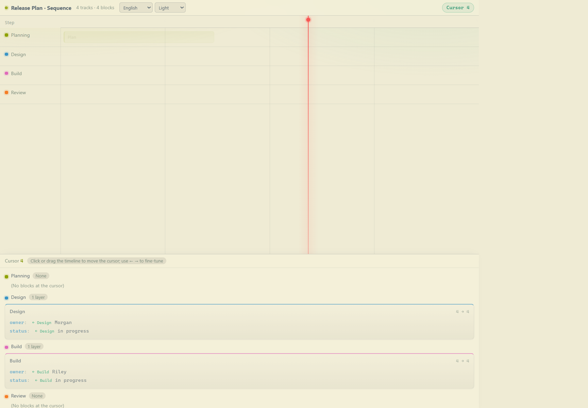
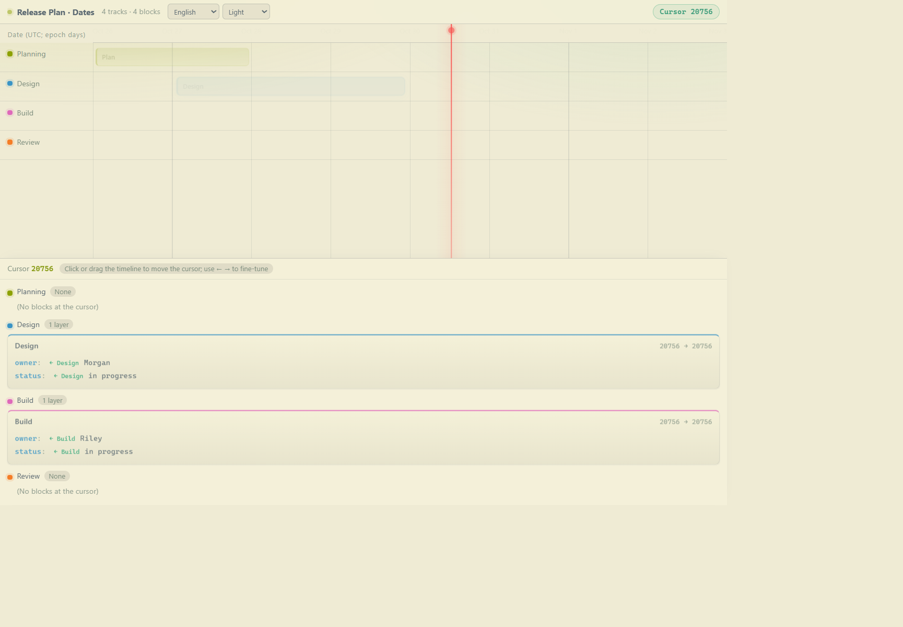
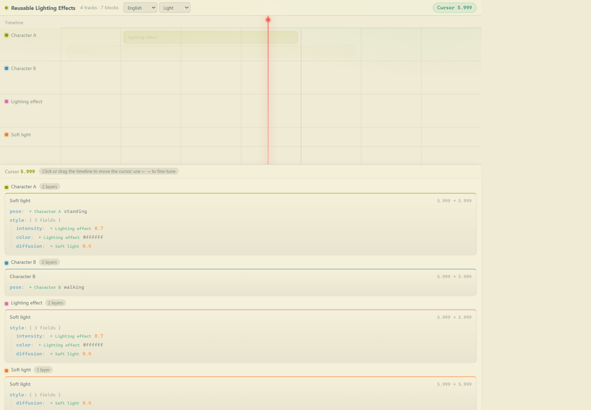

# Time Ledger MCP

[English](./README.md) | [简体中文](./README.zh-CN.md)

Time Ledger MCP 可以把结构化台账展示为可交互的时间线。使用 `show` 载入台账后，移动光标即可查看各个位置对应的内容。

服务只在内存中保留最近一次载入的台账，不会将数据写入磁盘；服务退出后，缓存随之清空。

## 截图

**序号坐标轴**



**带日期标签的数值坐标轴**



**全局 ID 层叠组合**



## 环境要求

- Node.js 18 或更高版本
- 支持 MCP 的客户端

## 安装

在仓库目录中安装依赖：

```powershell
npm install
```

若要在 VS Code 中全局使用，请将服务添加到用户级 `mcp.json`。示例中的路径需要替换为本仓库的绝对路径：

```json
{
  "servers": {
    "time-ledger": {
      "type": "stdio",
      "command": "node",
      "args": ["C:/path/to/time-ledger-mcp/src/server.js"]
    }
  }
}
```

VS Code 会在需要时启动 stdio 服务，并负责管理它与客户端的运行周期。

## 工具

| 工具 | 功能 |
| --- | --- |
| `show` | 载入台账、替换内存缓存并返回本地页面网址。参数可以是台账对象、JSON 文件路径或 JSON 文本。 |
| `open` | 使用系统默认浏览器打开本地页面。 |
| `help` | 说明台账格式与显示规则。默认返回英文；传入 `{"language":"zh"}` 可获取中文版。 |

## 首次使用

1. 创建或修改台账 JSON 前先调用 `help`；需要中文时传入 `{"language":"zh"}`。它是格式规范的权威来源。
2. 选择示例，例如 `examples/sequence-ledger.json`、`examples/date-ledger.json` 或 `examples/example.json`。
3. 调用 `show` 并传入文件路径。如果不确定 MCP 服务的工作目录，请使用绝对路径。
4. 调用 `open` 打开页面，再点击或拖动时间线；可用左右方向键微调光标。

页面默认使用英文和 Auto 外观。可在标题栏切换中文或强制浅色/深色。两项选择都会保存在此页面 origin 对应的浏览器 `localStorage` 中。Auto 会跟随操作系统配色变化。语言切换只翻译界面文本，不改变台账内容。

## 序号与日期坐标轴

坐标轴始终是数值。序号数据可直接使用步骤号、帧号等数值，并设置合适的 `axis.label`。日期数据需先转换为 UTC Unix 天数或秒数，再用 `axis.ticks` 提供易读的日期标签；`start` 和 `end` 不会自动解析日期字符串。`examples/date-ledger.json` 展示了 Unix 天数示例，光标和详情区间仍显示数值。

## 全局 ID 组合

本项目的特色是通过全局唯一 ID 复用并组合内容：

1. 一条轨道代表一个事项；它的本底区块使用与轨道相同的 ID。
2. 其他轨道中的区块可以使用该 ID，在自身区间内引用此事项。
3. 来源轨道中不同 ID 的区块会形成有序子轨道。更靠上的子轨道优先覆盖冲突字段；嵌套对象递归合并，数组整体替换。
4. 来源轨道先在本地完成组合，再递归解析引用。来源结果仅在时间交集内生效；循环引用会被拒绝。

首次引用尚无轨道的 ID 时，系统会用该引用初始化轨道。之后的引用不会自动复制新区块；需要显式添加更多来源区块。打开 `examples/example.json` 并将光标移入光影区间，可以查看组合结果及各字段的来源标记。

提示词示例：

> 请先调用 `time-ledger` MCP 的 `help` 工具了解当前格式，再按返回的规则在当前工作区创建 `ledgers/daily-ledger.json`，并调用 `time-ledger.show` 载入台账。

`show` 接收文件路径时，相对路径以服务进程的工作目录为基准。如果无法确定该目录，请使用绝对路径。

## 本地开发

```powershell
npm test
npm run serve
npm run serve -- examples/example.json
npm run serve -- examples/sequence-ledger.json
npm run serve -- examples/date-ledger.json
```

`npm test` 会检查 MCP 工具、双语 help、ID 组合、首次初始化、循环引用与重叠校验、文件和对象载入、页面及台账 API。`npm run serve` 无需 MCP 客户端即可预览示例台账；按 Ctrl+C 停止。

页面服务监听 `127.0.0.1`，默认从端口 `7317` 开始，最多连续尝试 20 个端口。设置 `LEDGER_PORT` 可更改起始端口。

## 许可证

本项目采用 Apache License 2.0，详见 [LICENSE](./LICENSE)。
